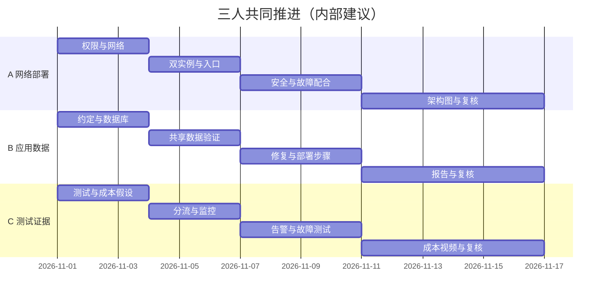

# 三人项目进度看板

最后同步：**2026-10-31 19:04 AEDT** · [同步运行记录](https://github.com/DiegoXue-coder/infs3701-cloud-team-2026/actions)

已完成并复核 **0 / 23** 项；等检查 **0** 项；被卡住 **0** 项。

**这是任务同步快照，不是 AWS 实时监控。** 点击任务读取最新正文和评论；没有同步回执的认领/提交仍在处理中。所有项目任务未完成前，不把协作系统搭建计作云服务完成。

## 每个人现在可以做什么

| 角色 / 成员 | 当前工作 | 前置条件满足的下一项 |
| --- | --- | --- |
| A / 待加入 | 无 | 无 |
| B / DiegoXue-coder | 无 | [T01 定题、需求、人员、Lab 环境](https://github.com/DiegoXue-coder/infs3701-cloud-team-2026/issues/1) |
| C / 待加入 | 无 | [T21 个人贡献、AI 记录与签名](https://github.com/DiegoXue-coder/infs3701-cloud-team-2026/issues/21) |

## 进行中 · 0

| 任务 | 负责人 / 角色 | 内部目标日期 | 等待什么 / 最近记录 |
| --- | --- | --- | --- |
| — | — | — | — |

## 被卡住 · 0

| 任务 | 负责人 / 角色 | 内部目标日期 | 等待什么 / 最近记录 |
| --- | --- | --- | --- |
| — | — | — | — |

## 等检查 · 0

| 任务 | 负责人 / 角色 | 内部目标日期 | 等待什么 / 最近记录 |
| --- | --- | --- | --- |
| — | — | — | — |

## 未开始 · 23

| 任务 | 负责人 / 角色 | 内部目标日期 | 等待什么 / 最近记录 |
| --- | --- | --- | --- |
| [T01 定题、需求、人员、Lab 环境](https://github.com/DiegoXue-coder/infs3701-cloud-team-2026/issues/1) | 未认领 / B | 2026-10-31 | 尚未认领 |
| [T02 建私有代码库与协作目录](https://github.com/DiegoXue-coder/infs3701-cloud-team-2026/issues/2) | 未认领 / A | 2026-11-01 | 先等 T01；尚未认领 |
| [T03 建任务板、询问冲突要求](https://github.com/DiegoXue-coder/infs3701-cloud-team-2026/issues/3) | 未认领 / C | 2026-11-01 | 先等 T01；尚未认领 |
| [T04 确定数据库及对接约定](https://github.com/DiegoXue-coder/infs3701-cloud-team-2026/issues/4) | 未认领 / B | 2026-11-01 | 先等 T01；尚未认领 |
| [T05 核对 Lab 权限、HTTPS 与预算](https://github.com/DiegoXue-coder/infs3701-cloud-team-2026/issues/5) | 未认领 / A | 2026-11-02 | 先等 T01；尚未认领 |
| [T06 设计并准备双 AZ 网络](https://github.com/DiegoXue-coder/infs3701-cloud-team-2026/issues/6) | 未认领 / A | 2026-11-03 | 先等 T04,T05；尚未认领 |
| [T07 旧应用接入托管数据库](https://github.com/DiegoXue-coder/infs3701-cloud-team-2026/issues/7) | 未认领 / B | 2026-11-03 | 先等 T02,T04,T05；尚未认领 |
| [T08 写测试清单、报告框架、成本假设](https://github.com/DiegoXue-coder/infs3701-cloud-team-2026/issues/8) | 未认领 / C | 2026-11-03 | 先等 T01,T04；尚未认领 |
| [T09 第一台应用部署与真实读写](https://github.com/DiegoXue-coder/infs3701-cloud-team-2026/issues/9) | 未认领 / A | 2026-11-04 | 先等 T06,T07；尚未认领 |
| [T10 加第二台及统一访问入口](https://github.com/DiegoXue-coder/infs3701-cloud-team-2026/issues/10) | 未认领 / A | 2026-11-05 | 先等 T09；尚未认领 |
| [T11 验证共享数据与无状态](https://github.com/DiegoXue-coder/infs3701-cloud-team-2026/issues/11) | 未认领 / B | 2026-11-06 | 先等 T10；尚未认领 |
| [T12 分流测试和监控页面](https://github.com/DiegoXue-coder/infs3701-cloud-team-2026/issues/12) | 未认领 / C | 2026-11-06 | 先等 T10；尚未认领 |
| [T13 创建并实测告警](https://github.com/DiegoXue-coder/infs3701-cloud-team-2026/issues/13) | 未认领 / C | 2026-11-08 | 先等 T12；尚未认领 |
| [T14 联合进行实例故障测试](https://github.com/DiegoXue-coder/infs3701-cloud-team-2026/issues/14) | 未认领 / C | 2026-11-09 | 先等 T11,T12；尚未认领 |
| [T15 网络、权限、加密安全核对](https://github.com/DiegoXue-coder/infs3701-cloud-team-2026/issues/15) | 未认领 / A | 2026-11-09 | 先等 T10,T11；尚未认领 |
| [T17 架构图与网络章节定稿](https://github.com/DiegoXue-coder/infs3701-cloud-team-2026/issues/17) | 未认领 / A | 2026-11-12 | 先等 T14,T15；尚未认领 |
| [T18 12 个月成本估算定稿](https://github.com/DiegoXue-coder/infs3701-cloud-team-2026/issues/18) | 未认领 / C | 2026-11-12 | 先等 T10,T15；尚未认领 |
| [T19 合并报告并复现部署步骤](https://github.com/DiegoXue-coder/infs3701-cloud-team-2026/issues/19) | 未认领 / B | 2026-11-13 | 先等 T13,T14,T15；尚未认领 |
| [T20 联合录真实操作并剪 60 秒视频](https://github.com/DiegoXue-coder/infs3701-cloud-team-2026/issues/20) | 未认领 / C | 2026-11-13 | 先等 T13,T14,T15；尚未认领 |
| [T21 个人贡献、AI 记录与签名](https://github.com/DiegoXue-coder/infs3701-cloud-team-2026/issues/21) | 未认领 / C | 2026-11-14 | 尚未认领 |
| [T22 五项交付交叉检查](https://github.com/DiegoXue-coder/infs3701-cloud-team-2026/issues/22) | 未认领 / B | 2026-11-15 | 先等 T17,T18,T19,T20,T21；尚未认领 |
| [T23 修复、冻结版本、准备上传](https://github.com/DiegoXue-coder/infs3701-cloud-team-2026/issues/23) | 未认领 / B | 2026-11-16 | 先等 T22；尚未认领 |
| [T24 提交、核对回执、按约定清理](https://github.com/DiegoXue-coder/infs3701-cloud-team-2026/issues/24) | 未认领 / B | 2026-11-17 | 先等 T23；尚未认领 |

## 已完成 · 0

| 任务 | 负责人 / 角色 | 内部目标日期 | 等待什么 / 最近记录 |
| --- | --- | --- | --- |
| — | — | — | — |

## 未启用（可选） · 1

| 任务 | 负责人 / 角色 | 内部目标日期 | 等待什么 / 最近记录 |
| --- | --- | --- | --- |
| [T16 已选增强的实施及验证](https://github.com/DiegoXue-coder/infs3701-cloud-team-2026/issues/16) | 未认领 / A | 2026-11-10 | 先等 T11,T12；可选增强尚未启用 |

## 建议时间安排

日期是计划，任务卡显示实际进度；成员加入后按空闲时间调整。课程正式截止为 2026-11-17 16:00 悉尼时间。

## 日常命令

`/team claim B` → 认领；`/team progress 实际进度` → 记录；`/team block 问题` → 遇阻；`/team submit deliveries/Txx/文件.json` → 等检查；另一人 `/team approve 检查说明` → 完成。

[AI 开场语](prompts/START.md) · [资料索引](sources/INDEX.md) · [协议](docs/team-protocol.md) · [操作手册](docs/execution-guide.md)
