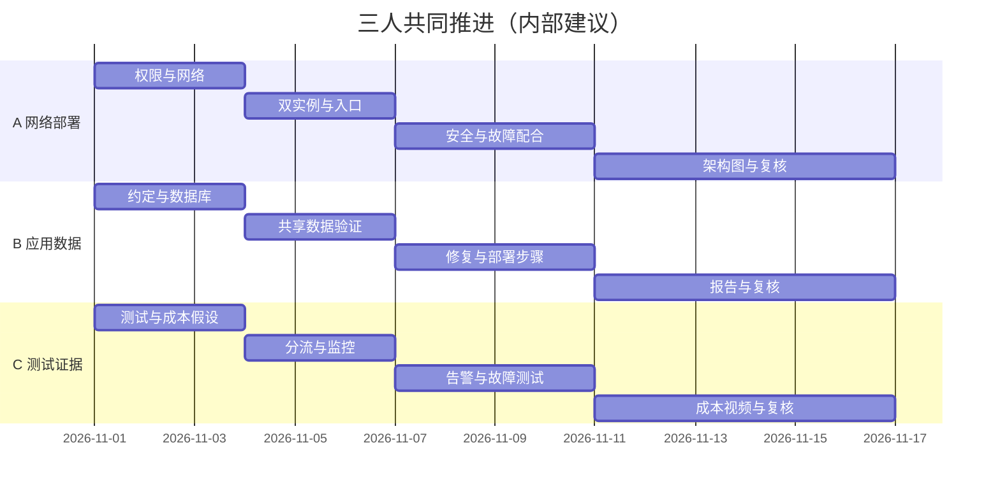

# 三人项目进度看板

最后同步：**2026-11-07 15:30 AEDT** · [在线任务入口](LIVE_BOARD.md) · [并行分工](docs/parallel-plan.md) · [系统运行方式](docs/system-status.md)

已完成并复核 **1 / 23** 项；等检查 **0** 项；被卡住 **0** 项。

**当前同步：每次聊天由 AI 运行同步助手；后台 Actions 暂停。** [系统状态](docs/system-status.md)。

**这是任务同步快照，不是 AWS 实时监控。** 点击任务读取最新正文和评论；没有同步回执的认领/提交仍在处理中。所有项目任务未完成前，不把协作系统搭建计作云服务完成。

**可以先独立准备，最后再联合验收。** 卡片区分开始条件和完成条件；不要等别人整张卡复核完才写代码、配置草稿或测试。

## 每个人现在可以做什么

| 角色 / 成员 | 当前工作 | 推荐先独立开展（最多三项） |
| --- | --- | --- |
| A / DiegoXue-coder | [T01 确认 Reading Tracker 升级方案、人员与 Lab](https://github.com/DiegoXue-coder/infs3701-cloud-team-2026/issues/1)；[T05 优先核查多人登录权限、Lab 限制与预算](https://github.com/DiegoXue-coder/infs3701-cloud-team-2026/issues/5)；[T06 设计并准备双 AZ 网络](https://github.com/DiegoXue-coder/infs3701-cloud-team-2026/issues/6)；[T09 第一台应用部署与真实读写](https://github.com/DiegoXue-coder/infs3701-cloud-team-2026/issues/9) | [T02 建私有代码库与协作目录](https://github.com/DiegoXue-coder/infs3701-cloud-team-2026/issues/2)；[T10 加第二台及统一访问入口](https://github.com/DiegoXue-coder/infs3701-cloud-team-2026/issues/10)；[T15 网络、权限、加密安全核对](https://github.com/DiegoXue-coder/infs3701-cloud-team-2026/issues/15) |
| B / Alex4325Li | [T04 确定数据库及对接约定](https://github.com/DiegoXue-coder/infs3701-cloud-team-2026/issues/4)；[T07 旧应用接入托管数据库](https://github.com/DiegoXue-coder/infs3701-cloud-team-2026/issues/7) | [T11 验证共享数据与无状态](https://github.com/DiegoXue-coder/infs3701-cloud-team-2026/issues/11)；[T19 合并报告并复现部署步骤](https://github.com/DiegoXue-coder/infs3701-cloud-team-2026/issues/19) |
| C / Marina057 | 无 | [T03 建任务板、询问冲突要求](https://github.com/DiegoXue-coder/infs3701-cloud-team-2026/issues/3)；[T12 分流测试和监控页面](https://github.com/DiegoXue-coder/infs3701-cloud-team-2026/issues/12)；[T13 创建并实测告警](https://github.com/DiegoXue-coder/infs3701-cloud-team-2026/issues/13) |

## 最近上报与回执

[完整机器可读回执](data/receipts.json) · [上报方法](docs/reporting.md)

| 任务 / 操作 | 操作者 | 处理与状态 | 证据与回执 |
| --- | --- | --- | --- |
| T07 / claim | Alex4325Li | accepted / 进行中 | — · [回执](https://github.com/DiegoXue-coder/infs3701-cloud-team-2026/issues/7#issuecomment-6702264513) |
| T08 / approve | DiegoXue-coder | accepted / 已完成 | [pass · 执行记录](https://github.com/DiegoXue-coder/infs3701-cloud-team-2026/blob/cb07163da0e2beb69797902b433efd8999fd4849/evidence/T08/2026-11-04-statistics-run.log) · [回执](https://github.com/DiegoXue-coder/infs3701-cloud-team-2026/issues/8#issuecomment-6683439053) |
| T08 / submit | Marina057 | accepted / 等检查 | [pass · 执行记录](https://github.com/DiegoXue-coder/infs3701-cloud-team-2026/blob/cb07163da0e2beb69797902b433efd8999fd4849/evidence/T08/2026-11-04-statistics-run.log) · [回执](https://github.com/DiegoXue-coder/infs3701-cloud-team-2026/issues/8#issuecomment-6624798454) |
| T08 / claim | Marina057 | accepted / 进行中 | — · [回执](https://github.com/DiegoXue-coder/infs3701-cloud-team-2026/issues/8#issuecomment-6624699434) |
| T04 / report | Alex4325Li | accepted / 进行中 | [partial · 执行记录](https://github.com/DiegoXue-coder/infs3701-cloud-team-2026/blob/5a8bf70d584b1c5d16eebc8d45d48256a374f4d1/evidence/T04/2026-11-03-baseline.log) · [回执](https://github.com/DiegoXue-coder/infs3701-cloud-team-2026/issues/4#issuecomment-6598777623) |
| T04 / claim | Alex4325Li | accepted / 进行中 | — · [回执](https://github.com/DiegoXue-coder/infs3701-cloud-team-2026/issues/4#issuecomment-6598745262) |
| T09 / report | DiegoXue-coder | accepted / 进行中 | [partial · 执行记录](https://github.com/DiegoXue-coder/infs3701-cloud-team-2026/blob/bb3be2edc882e79c4147006d2d84b8c0610c7b5e/evidence/T09/2026-11-01-maintenance-validation.log) · [回执](https://github.com/DiegoXue-coder/infs3701-cloud-team-2026/issues/9#issuecomment-6554228452) |
| T06 / report | DiegoXue-coder | accepted / 进行中 | [partial · 执行记录](https://github.com/DiegoXue-coder/infs3701-cloud-team-2026/blob/bb3be2edc882e79c4147006d2d84b8c0610c7b5e/evidence/T09/2026-11-01-final-readback.log) · [回执](https://github.com/DiegoXue-coder/infs3701-cloud-team-2026/issues/6#issuecomment-6554227245) |
| T05 / report | DiegoXue-coder | accepted / 进行中 | [partial · 执行记录](https://github.com/DiegoXue-coder/infs3701-cloud-team-2026/blob/bb3be2edc882e79c4147006d2d84b8c0610c7b5e/evidence/T09/2026-11-01-final-readback.log) · [回执](https://github.com/DiegoXue-coder/infs3701-cloud-team-2026/issues/5#issuecomment-6554226019) |
| T09 / report | DiegoXue-coder | accepted / 进行中 | [partial · 执行记录](https://github.com/DiegoXue-coder/infs3701-cloud-team-2026/blob/b31298800bcbe4671dad47162b616ac1cae41941/evidence/T06/2026-11-01-foundation-execution.log) · [回执](https://github.com/DiegoXue-coder/infs3701-cloud-team-2026/issues/9#issuecomment-6553951968) |

## 进行中 · 6

| 任务 | 负责人 / 角色 | 内部目标日期 | 等待什么 / 最近记录 |
| --- | --- | --- | --- |
| [T01 确认 Reading Tracker 升级方案、人员与 Lab](https://github.com/DiegoXue-coder/infs3701-cloud-team-2026/issues/1) | DiegoXue-coder / A | 2026-10-31 | 实际上报（partial，尚未完成）：Built shared self-service onboarding, member-selected vacant B/C roles, authenticated enrollment command, setup script, role-specific first tasks, and machine-readable handoff defaults. |
| [T04 确定数据库及对接约定](https://github.com/DiegoXue-coder/infs3701-cloud-team-2026/issues/4) | Alex4325Li / B | 2026-11-01 | 实际上报（partial，尚未完成）：完成 B 首次配置、旧 S3 代码核对和首版字段/运行/存储契约；修复 capture_run 在 Python3.9 的 newline 参数兼容性。 |
| [T05 优先核查多人登录权限、Lab 限制与预算](https://github.com/DiegoXue-coder/infs3701-cloud-team-2026/issues/5) | DiegoXue-coder / A | 2026-11-02 | 实际上报（partial，尚未完成）：Verified Lab role access on both private hosts, encrypted roots and restricted paths; OpenTunnel denied, alternative boot diagnostics passed. HTTPS/domain unresolved; displayed delayed Lab usage $1.30/$50. |
| [T06 设计并准备双 AZ 网络](https://github.com/DiegoXue-coder/infs3701-cloud-team-2026/issues/6) | DiegoXue-coder / A | 2026-11-03 | 完成前需 T04,T05；实际上报（partial，尚未完成）：Created and read back actual two-AZ ALB/private-host/gateway/route/security-group foundation; scoped HTTPS service paths passed from both private hosts; unused SSH paths closed. |
| [T07 旧应用接入托管数据库](https://github.com/DiegoXue-coder/infs3701-cloud-team-2026/issues/7) | Alex4325Li / B | 2026-11-03 | 完成前需 T04；已认领 |
| [T09 第一台应用部署与真实读写](https://github.com/DiegoXue-coder/infs3701-cloud-team-2026/issues/9) | DiegoXue-coder / A | 2026-11-04 | 完成前需 T06,T07；实际上报（partial，尚未完成）：Launched two private systemd/Gunicorn infrastructure placeholders, verified routing and per-host boot/role/data-read/object-hash checks; actual alarm OK->ALARM->OK and both targets healthy. Business app not yet deploye |

## 被卡住 · 0

| 任务 | 负责人 / 角色 | 内部目标日期 | 等待什么 / 最近记录 |
| --- | --- | --- | --- |
| — | — | — | — |

## 等检查 · 0

| 任务 | 负责人 / 角色 | 内部目标日期 | 等待什么 / 最近记录 |
| --- | --- | --- | --- |
| — | — | — | — |

## 未开始 · 16

| 任务 | 负责人 / 角色 | 内部目标日期 | 等待什么 / 最近记录 |
| --- | --- | --- | --- |
| [T02 建私有代码库与协作目录](https://github.com/DiegoXue-coder/infs3701-cloud-team-2026/issues/2) | 未认领 / A | 2026-11-01 | 尚未认领 |
| [T03 建任务板、询问冲突要求](https://github.com/DiegoXue-coder/infs3701-cloud-team-2026/issues/3) | 未认领 / C | 2026-11-01 | 尚未认领 |
| [T10 加第二台及统一访问入口](https://github.com/DiegoXue-coder/infs3701-cloud-team-2026/issues/10) | 未认领 / A | 2026-11-05 | 完成前需 T09；尚未认领 |
| [T11 验证共享数据与无状态](https://github.com/DiegoXue-coder/infs3701-cloud-team-2026/issues/11) | 未认领 / B | 2026-11-06 | 完成前需 T10；尚未认领 |
| [T12 分流测试和监控页面](https://github.com/DiegoXue-coder/infs3701-cloud-team-2026/issues/12) | 未认领 / C | 2026-11-06 | 完成前需 T10；尚未认领 |
| [T13 创建并实测告警](https://github.com/DiegoXue-coder/infs3701-cloud-team-2026/issues/13) | 未认领 / C | 2026-11-08 | 完成前需 T12；尚未认领 |
| [T14 联合进行实例故障测试](https://github.com/DiegoXue-coder/infs3701-cloud-team-2026/issues/14) | 未认领 / C | 2026-11-09 | 完成前需 T11,T12；尚未认领 |
| [T15 网络、权限、加密安全核对](https://github.com/DiegoXue-coder/infs3701-cloud-team-2026/issues/15) | 未认领 / A | 2026-11-09 | 完成前需 T09,T10；尚未认领 |
| [T17 架构图与网络章节定稿](https://github.com/DiegoXue-coder/infs3701-cloud-team-2026/issues/17) | 未认领 / A | 2026-11-12 | 完成前需 T15；尚未认领 |
| [T18 12 个月成本估算定稿](https://github.com/DiegoXue-coder/infs3701-cloud-team-2026/issues/18) | 未认领 / C | 2026-11-12 | 完成前需 T10；尚未认领 |
| [T19 合并报告并复现部署步骤](https://github.com/DiegoXue-coder/infs3701-cloud-team-2026/issues/19) | 未认领 / B | 2026-11-13 | 完成前需 T13,T14,T15；尚未认领 |
| [T20 联合录真实操作并剪 60 秒视频](https://github.com/DiegoXue-coder/infs3701-cloud-team-2026/issues/20) | 未认领 / C | 2026-11-13 | 完成前需 T10,T11,T12；尚未认领 |
| [T21 个人贡献、AI 记录与签名](https://github.com/DiegoXue-coder/infs3701-cloud-team-2026/issues/21) | 未认领 / C | 2026-11-14 | 尚未认领 |
| [T22 五项交付交叉检查](https://github.com/DiegoXue-coder/infs3701-cloud-team-2026/issues/22) | 未认领 / A | 2026-11-15 | 完成前需 T17,T18,T19,T20,T21；尚未认领 |
| [T23 修复、冻结版本、准备上传](https://github.com/DiegoXue-coder/infs3701-cloud-team-2026/issues/23) | 未认领 / A | 2026-11-16 | 完成前需 T22；尚未认领 |
| [T24 提交、核对回执、按约定清理](https://github.com/DiegoXue-coder/infs3701-cloud-team-2026/issues/24) | 未认领 / A | 2026-11-17 | 完成前需 T23；尚未认领 |

## 已完成 · 1

| 任务 | 负责人 / 角色 | 内部目标日期 | 等待什么 / 最近记录 |
| --- | --- | --- | --- |
| [T08 写测试清单、报告框架、成本假设](https://github.com/DiegoXue-coder/infs3701-cloud-team-2026/issues/8) | Marina057 / C | 2026-11-03 | 复核通过：T08准备阶段通过。经DiegoXue-coder本人授权，由Codex在A工作区独立复跑：10项统计+7项loopback HTTP工具测试全部通过；告警11字段及资源维度一致；交付和15份证据共16个Git blob与提交回执匹配；原4条样本保留且标为local-fixture。已核对core测试矩阵、监控/恢复方案、成本假设和报告/视频框架，未发现阻止T08批准的缺陷。源码哈希差异已证实为CRLF/LF差异，AST一致。详细复核及日志见 https://github.com/Di |

## 未启用（可选） · 1

| 任务 | 负责人 / 角色 | 内部目标日期 | 等待什么 / 最近记录 |
| --- | --- | --- | --- |
| [T16 已选增强的实施及验证](https://github.com/DiegoXue-coder/infs3701-cloud-team-2026/issues/16) | 未认领 / A | 2026-11-10 | 完成前需 T11,T12；可选增强尚未启用 |

## 建议时间安排

日期是计划，任务卡显示实际进度；成员加入后按空闲时间调整。课程正式截止为 2026-11-17 16:00 悉尼时间。

## 日常命令

`/team claim B` → 认领；`/team progress 实际进度` → 记录；`/team block 问题` → 遇阻；`/team submit deliveries/Txx/文件.json` → 等检查；另一人 `/team approve 检查说明` → 完成。

[AI 开场语](prompts/START.md) · [资料索引](sources/INDEX.md) · [协议](docs/team-protocol.md) · [操作手册](docs/execution-guide.md)
